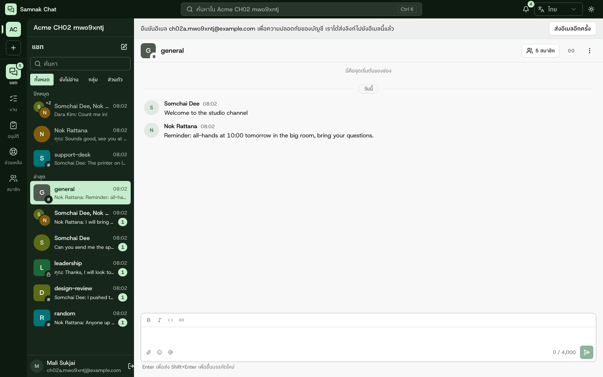
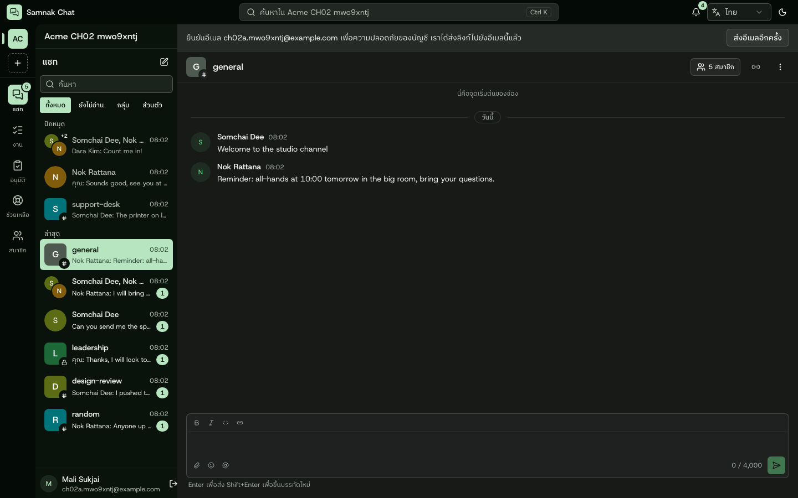
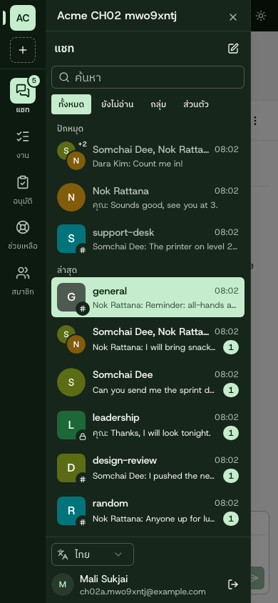

# Samnak Chat

Self-hosted chat for organizations, with work management built in: tasks, approval requests and a helpdesk, all usable from inside a conversation.

> Status: **v0.1.0**. See [`CHANGELOG.md`](CHANGELOG.md) for what is in it.



<table>
  <tr>
    <td width="70%"></td>
    <td width="30%"></td>
  </tr>
</table>

## What it does

| Module | Kind | What it gives you |
| --- | --- | --- |
| `auth` | core | Sign-up, sign-in, email verification, password reset, and a list of signed-in devices |
| `workspace` | core | Workspaces, members and roles, invites, groups, and an audit log |
| `chat` | core | Channels, direct messages, threads, reactions, pins, file attachments, slash commands, and realtime delivery |
| `notify` | optional, on by default | Notifications with a bell and unread count, per-kind switches, muted channels, and do-not-disturb hours |
| `task` | optional | Tasks with reminders before the due date and when overdue. Task cards appear in chat |
| `approval` | optional | Approval requests that can be approved, rejected or cancelled, with attachments. Request cards appear in chat |
| `helpdesk` | optional | Queues, categories, tickets, assignment, status, public and internal comments, and a ticket made from a chat message |

Core modules are always on. Optional modules are switched on with `MODULES_ENABLED`. See [Modules](#modules).

The web app is in Thai and English, has a light and a dark theme, and works on phones as well as desktops.

Not in v0.1.0: push notifications, email from the notification module, a desktop app, a mobile app and helpdesk SLA checks. See [`docs/architecture.md`](docs/architecture.md) for what is planned.

## Install on your own server

You need Docker with Compose v2 and Git. The install takes a few minutes, mostly for the first image build.

```sh
git clone https://github.com/KPV2004/samnak-chat.git
cd samnak-chat
cp .env.example .env        # then set JWT_SECRET, POSTGRES_PASSWORD and the MinIO keys
docker compose --env-file .env -f deploy/compose.prod.yml up -d --wait
```

Open `http://localhost`, sign up, and create a workspace. For HTTPS, the host name, the ports, backups and upgrades, read [`deploy/README.md`](deploy/README.md).

## Development setup

You need Go 1.26+, Node 22+ and Docker.

```sh
cp .env.example .env
npm install
make up          # PostgreSQL, Redis, MinIO and Mailpit in Docker
make migrate     # create the tables of the enabled modules
make server      # API on http://localhost:8080
make web         # web app on http://localhost:5173
```

To read the emails the server sends, set `SMTP_HOST=localhost` in `.env`, then open Mailpit at http://localhost:8025. With `SMTP_HOST` empty, the server writes each email to its log instead. The full list of commands is in [`CONTRIBUTING.md`](CONTRIBUTING.md).

## Modules

The server is a modular monolith. Each feature is a module. The core modules always run. The optional modules run only when you list them in `MODULES_ENABLED`.

```sh
MODULES_ENABLED=notify,task,approval,helpdesk
```

| Setting | Modules enabled |
| --- | --- |
| Not set | `auth`, `workspace`, `chat`, `notify` |
| Empty (`MODULES_ENABLED=`) | `auth`, `workspace`, `chat` only |
| `task,helpdesk` | the core modules, `task` and `helpdesk` |

A disabled module returns 404 for its routes, and its menu items are hidden in the web app. Its data stays in the database, so enabling the module again brings it back. `GET /api/v1/meta` lists the modules that are on.

To check one module set, run `bash scripts/check-modules.sh <MODULES_ENABLED or unset> <optional modules>`. For example, `bash scripts/check-modules.sh task task`.

## Documentation

- [Requirements (SRS, Thai)](docs/srs.md)
- [Architecture](docs/architecture.md)
- [Decision records](docs/adr/)
- [Web design system](docs/ui.md)
- [Self-hosting](deploy/README.md)
- [Landing page](https://kpv2004.github.io/samnak-chat/) ([Thai](https://kpv2004.github.io/samnak-chat/th/); source in [`apps/landing/`](apps/landing/))
- [Contributing](CONTRIBUTING.md)
- [Changelog](CHANGELOG.md)
- [Plan and task board](tasks/plan.md) and [`tasks/todo.md`](tasks/todo.md)

## Repository layout

```
apps/server/     Go modular monolith (Chi, Huma, pgx, sqlc, River)
apps/web/        React + Vite + TypeScript (see apps/web/README.md)
apps/desktop/    Tauri desktop app (planned, phase P2)
apps/mobile/     Expo mobile app (planned, phase P3)
packages/core/   API client, OpenAPI types, WebSocket, chat logic (no DOM)
packages/ui/     Components shared by web and desktop (planned)
deploy/          Docker Compose for self-hosting and development services
docs/            SRS, architecture, ADRs, design system
tasks/           Plan and task board
scripts/         Coverage and module checks
```

## License

[AGPL-3.0](LICENSE)
