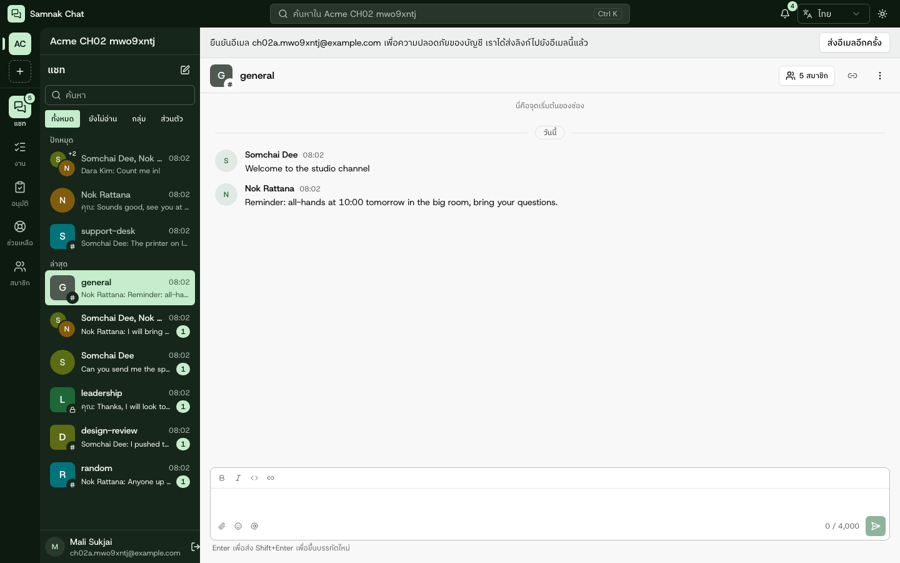
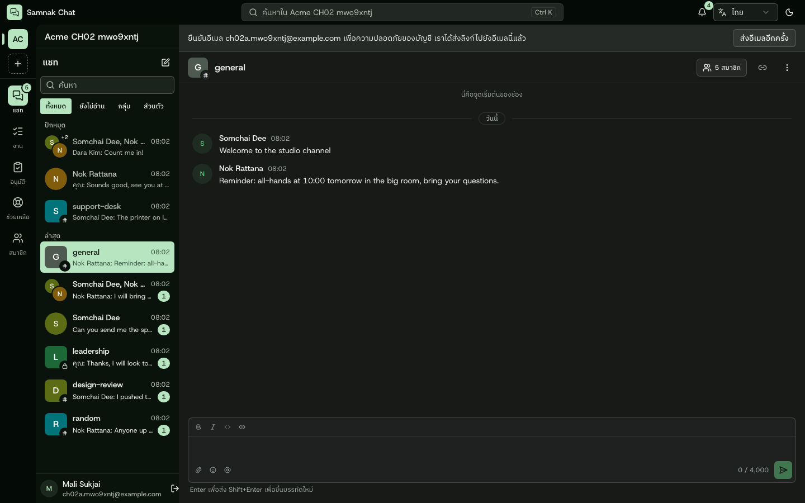
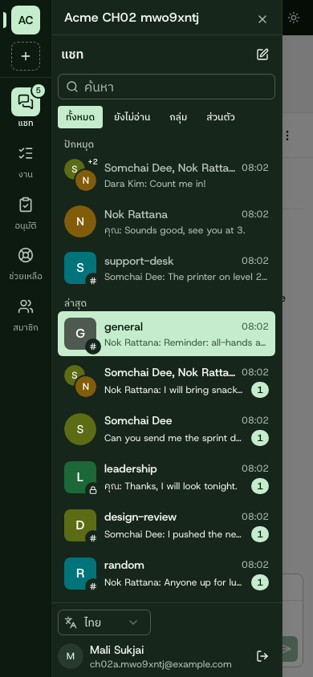

# Samnak Chat web

The browser app of [Samnak Chat](../../README.md): team chat for organisations, with tasks, approvals and a helpdesk inside the conversation. React, Vite and TypeScript, talking to the Go server in [`apps/server`](../server) over REST and one WebSocket.



<table>
  <tr>
    <td width="70%"></td>
    <td width="30%"></td>
  </tr>
</table>

## What it does

- **Messenger.** One list of every channel, direct message and group chat, each with its picture, the latest message, the time and the unread count. Pin the ones you use to the top; search and filter by unread, groups or direct.
- **Chat.** Messages grouped by sender, day dividers and a "new messages" line, reactions, threads in a side pane, mentions, `/` commands, file attachments, editing and deleting. Realtime, and nothing is lost or doubled when the connection drops.
- **Cards in chat.** Tasks, approval requests and helpdesk tickets appear as cards you can act on where they were posted.
- **Apps.** Tasks, Approvals, Helpdesk (queues, categories, public and internal comments), Groups, Members, Invites and the audit log, each shown only when the server has that module turned on.
- **Notifications.** A bell with the unread count, per-kind switches, muted channels and do-not-disturb hours.
- **Account.** Sign-up with email verification, password reset, profile, language and time zone, and the list of signed-in devices.
- **Thai and English,** light and dark, from 360 px wide. Times are stored in UTC and shown in the user's time zone.

## Run it

You need Node 22+, Go 1.26+ and Docker. From the repository root:

```sh
cp .env.example .env
npm install
make up          # postgres, redis, minio (and mailpit) in Docker
make migrate     # create the tables of the enabled modules
make server      # API on http://localhost:8080
make web         # this app on http://localhost:5173
```

Vite proxies `/api` (including the WebSocket at `/api/v1/ws`) to `http://localhost:8080`. To use a server on another address:

```sh
API_URL=http://localhost:8091 npm run dev -w apps/web
```

Which apps appear follows `MODULES_ENABLED` in `.env` (for example `notify,task,approval,helpdesk`); the web reads the list from `GET /api/v1/meta`.

To self-host the whole stack (server, web behind Caddy with TLS, database and storage), follow [`deploy/README.md`](../../deploy/README.md).

## Scripts

Run in `apps/web`, or from the root with `-w apps/web`.

| Command | What it does |
| --- | --- |
| `npm run dev` | Vite dev server with hot reload |
| `npm run build` | Type-check with `tsc`, then build to `dist/` |
| `npm test` | Vitest component tests in jsdom |
| `npm run lint` | ESLint over `src/` |

The API client and its types live in [`packages/core`](../../packages/core). After a server API change, run `make openapi` from the root: it regenerates `apps/server/api/openapi.yaml` and `packages/core/src/api/schema.d.ts`. CI fails when they are out of date.

## Layout

```
src/
  App.tsx           routes; each app's pages load on first visit
  pages/            sign-in, account, members, invites, audit, settings, shared page parts
  components/       the shell (workspace rail, sidebar, top bar) and shared components
  components/ui/    shadcn/ui components, copied in and ours to edit
  chat/             Messenger list, channel view, composer, threads, cards
  task/ approval/ helpdesk/ groups/ notify/
                    one folder per module: its pages, cards and API hooks
  state/            session, chat store, theme, locale, React Query hooks
  i18n/             Thai and English strings, one file per area
  index.css         the only stylesheet: fonts, Tailwind and the design tokens
```

## Design system

The look follows Slack and Lark: a dark workspace rail and sidebar, a calm content area, one green accent, one radius scale, and hover and press feedback on every control. Tailwind v4 with shadcn/ui (Radix). The tokens, components and rules for building a page are in [`docs/ui.md`](../../docs/ui.md); read it before adding a screen.

## Tests

Component tests render the whole app against a mocked server: `renderApp({ route, routes })` from `src/test-utils.tsx` takes a map of `"METHOD /path"` to a handler and records every call, so a test can click through a page and assert on the requests it sent. New behaviour comes with a test, and `npm run build`, `npm test` and `npm run lint` must pass before a change is merged.

## License

AGPL-3.0, like the rest of the repository. See [`LICENSE`](../../LICENSE).
