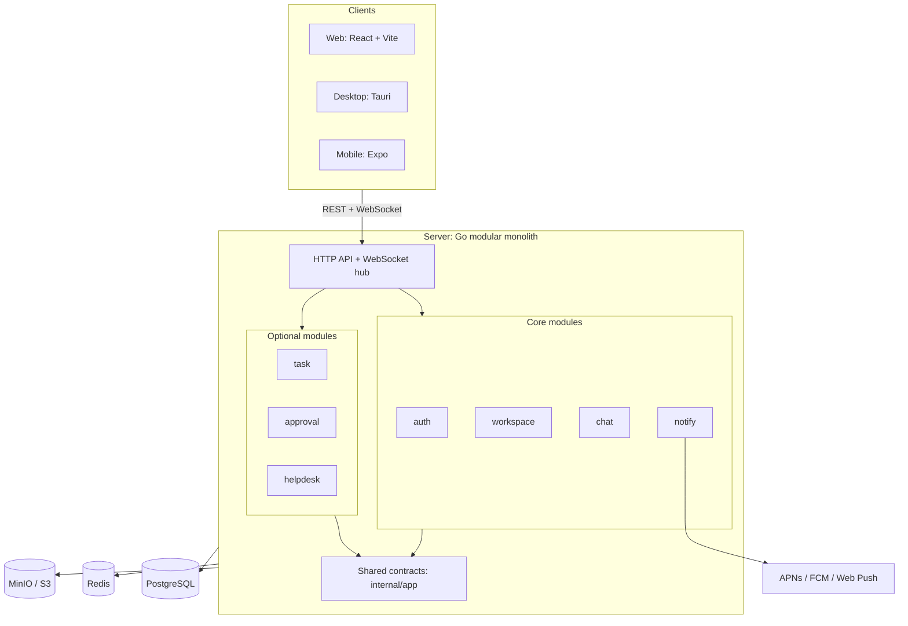
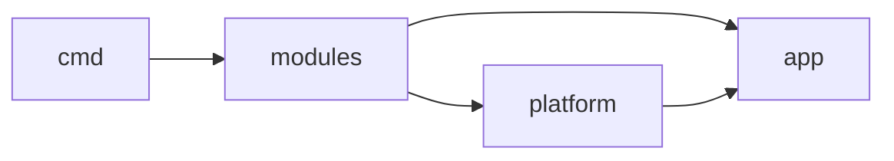
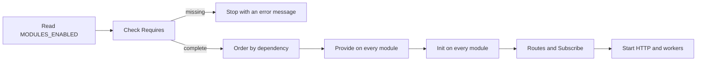
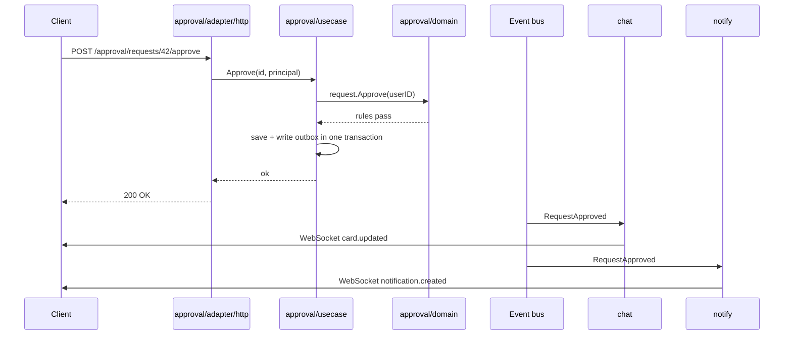

# Samnak Chat Architecture

This document describes what the system is made of, how the parts talk to each other, and why the main decisions were made. It is written for anyone who will change the code or add a module. System requirements live in [`srs.md`](./srs.md).

## 1. Overview

Samnak Chat is a self-hosted chat for organizations with work management built in: tasks, approval requests and a helpdesk, all usable from inside a conversation.

The server is a **modular monolith** written in Go. It is one program and one deployment, split into feature modules that can be switched on or off. Each module uses **Clean Architecture** internally.



## 2. Design principles

1. **Modules do not call each other directly.** A module publishes an event and other modules subscribe. The publisher does not know who is listening.
2. **Disabling a module must not break the system.** A bad configuration stops the server at startup with a clear message, instead of failing when a user clicks a button.
3. **Business rules live in the domain layer,** which knows nothing about the database, HTTP or JSON.
4. **The database is the source of truth.** WebSocket and push only tell clients sooner.
5. **The API is not tied to any client.** Everything the web app does goes through the public API, so desktop and mobile can use it too.

## 3. Server layout

```
apps/server/
├── cmd/
│   ├── server/main.go        # composition root: wires modules and starts the server
│   └── migrate/main.go       # runs migrations
├── internal/
│   ├── app/                  # shared contracts: interfaces and types only
│   ├── platform/             # infrastructure, no business logic
│   └── modules/              # all features
│       ├── auth/  workspace/  chat/  notify/
│       └── task/  approval/  helpdesk/
├── api/openapi.yaml          # generated from code
└── deploy/
```

### 3.1 `internal/app`: shared contracts

| File | Contents |
| --- | --- |
| `module.go` | The `Module` interface |
| `deps.go` | The `Deps` struct passed to every module at startup |
| `registry.go` | Checks dependencies, orders modules and starts them |
| `event.go` | `Event`, `Publisher`, `EventBus` |
| `services.go` | Service registry: `Provide` and `Lookup` |
| `notification.go` | `Notification`, `NotificationRule`, `NotificationRegistry` |
| `card.go` | `CardRegistry` for chat cards |
| `auth.go` | `Principal` (current user, workspace and role) carried in the context |
| `errors.go` | Standard errors: NotFound, Forbidden, Conflict, Invalid |

This package imports nothing else from the project. Modules depend on it instead of on each other.

### 3.2 `internal/platform`: infrastructure

| Package | Responsibility |
| --- | --- |
| `config` | Reads configuration from the environment |
| `database` | pgx pool and `TxManager` |
| `redis` | Redis connection |
| `storage` | Presigned URLs for uploads and downloads |
| `eventbus` | `EventBus` implementations: in-memory and outbox |
| `jobs` | Job queue (River) |
| `realtime` | WebSocket hub and presence |
| `httpx` | Router, middleware and error-to-JSON mapping |
| `observability` | Logging, metrics, health checks |

`platform` knows no feature. For example, `realtime` knows how to deliver a payload to a user, but not whether that payload is a chat message or a ticket.

## 4. Dependency rules



- `cmd` is the only place that knows every module.
- A module may import only `api.go` and `events.go` from another module. Those two files are its public surface.
- Importing another module's `domain`, `usecase` or `adapter` is forbidden.
- Reading or writing another module's tables is forbidden.

CI enforces these rules with `depguard`. A violation fails the build.

## 5. Modules

### 5.1 Interface

```go
type Module interface {
    Name() string
    Requires() []string        // modules this one cannot run without
    Provide(s *Services)       // phase 1: expose services to other modules
    Init(d *Deps) error        // phase 2: build use cases, register rules
    Routes(r chi.Router)       // mount endpoints under /api/v1/{name}
    Subscribe(bus EventBus)    // listen to events from other modules
}
```

### 5.2 Startup sequence



`Provide` runs on every module before any `Init` runs, so modules can look up each other's services regardless of order.

### 5.3 Inside a module

```
approval/
├── module.go            # wires adapters to use cases and registers with the system
├── api.go               # interfaces other modules may call
├── events.go            # events this module publishes
├── domain/              # entities and business rules
├── usecase/             # application flows and ports (required interfaces)
├── adapter/
│   ├── http/            # handlers and JSON shapes
│   ├── postgres/        # Repository implemented with sqlc
│   └── jobs/            # job queue workers
└── migrations/
```

Dependencies inside a module point one way: `adapter → usecase → domain`. Inner layers do not know outer layers.

| Layer | Contains | Must not contain |
| --- | --- | --- |
| domain | Entities, state transitions, business errors | SQL, HTTP, JSON tags, calls to other modules |
| usecase | The steps of one capability, transaction boundaries, ports | pgx or sqlc types, `http.Request` |
| adapter | Input and output mapping, calls to external systems | Business rules |

A simple module does not need every layer. Interfaces are created only where a boundary is crossed: the database, events and other modules.

## 6. Communication between modules

There are four mechanisms, listed in order of preference.

| Mechanism | Use it to | If the target module is disabled |
| --- | --- | --- |
| Event bus | Announce that something happened | No subscribers; not an error |
| Notification registry | Notify a user | A no-op registry is used |
| Card registry | Show a card in chat | chat is a core module and is always on |
| Service registry | Query or command another module synchronously | `Lookup` returns `false`; use a fallback |

### 6.1 Event bus

```go
type Event interface {
    EventName() string        // e.g. "approval.request_approved"
}

type Publisher interface {
    Publish(ctx context.Context, evt Event) error
}
```

- An event is a struct declared in the publishing module's `events.go`, named in the past tense.
- A handler that returns an error or panics is logged and does not affect the publisher.
- Events are sent only after the transaction commits. They are written to `outbox_events` in the same transaction as the data, and a relay publishes them.
- Delivery is at least once, so handlers must be idempotent.
- Fields may be added to an event. Existing fields must not be removed or change meaning.

### 6.2 Notification registry

The source module decides who is notified and what the message says. The notify module decides how and when it is delivered.

```go
d.Notifications.On("approval.request_approved",
    func(ctx context.Context, evt app.Event) ([]app.Notification, error) {
        e := evt.(RequestApproved)
        return []app.Notification{{
            UserID: e.RequesterID,
            Kind:   "approval.approved",
            Title:  "Your request was approved",
            Link:   "/approvals/" + e.ID,
        }}, nil
    })
```

notify stores the notification, checks the user's preferences and picks a channel: WebSocket when the user is online, otherwise push through the job queue.

### 6.3 Card registry

A chat message has `kind`, `payload` and `fallback_text`. A module registers its own card kinds, such as `approval.request`. The chat module stores and delivers cards without understanding the `payload`.

When state changes, the owning module calls `Cards.Update(messageID, payload)` and chat sends `card.updated` to everyone in the channel. If the owning module is disabled, clients show `fallback_text`.

### 6.4 Service registry

```go
// provider
app.Provide[task.Creator](s, m.createUC)

// consumer
creator, ok := app.Lookup[task.Creator](d.Services)
if !ok {
    creator = task.NoopCreator{}
}
```

Use it only when an event is not enough, for example when the caller needs a result immediately.

## 7. Enabling and disabling modules

- `MODULES_ENABLED` lists the enabled modules. Core modules are always on.
- Hard dependencies are declared in `Requires()`. If one is missing, the server does not start.
- Soft dependencies use `Lookup` with a fallback.
- Endpoints of a disabled module are never mounted, so they return 404.
- `GET /api/v1/meta` returns the enabled modules and features so clients can hide menus.
- Disabling a module keeps its tables and data. Enabling it again picks up where it left off.
- Jobs with no registered worker are cancelled instead of staying in the queue.
- CI starts the server with several module combinations.

## 8. Data

### 8.1 Tenant isolation

Every table that holds organization data has a `workspace_id` column, and every query filters on it. Middleware checks that the user is a member of the workspace and puts a `Principal` into the context. Use cases read `workspace_id` from the `Principal` only, never from client input.

### 8.2 Tables and migrations

- Table names are prefixed with the module name, such as `chat_messages` and `helpdesk_tickets`.
- Migrations live in each module's folder and run only for enabled modules.
- IDs are UUIDv7. Timestamps are `timestamptz` in UTC.
- A module refers to another module's data by ID only. There are no foreign keys across modules, so a module can be disabled or split out.

### 8.3 Transactions

`TxManager` keeps the transaction in the `context`, so a use case sets the transaction boundary without knowing pgx.

```go
return uc.Tx.Do(ctx, func(ctx context.Context) error {
    r, err := uc.Repo.Get(ctx, id)
    if err != nil { return err }
    if err := r.Approve(userID); err != nil { return err }
    if err := uc.Repo.Save(ctx, r); err != nil { return err }
    return uc.Pub.Publish(ctx, RequestApproved{ID: r.ID})
})
```

## 9. Realtime

### 9.1 Message guarantees

| Problem | Solution |
| --- | --- |
| Duplicate sends after a network drop | The client generates `client_msg_id`; the database enforces uniqueness on (sender_id, client_msg_id) |
| Different order on different devices | The server assigns a per-channel `seq` that increases by one |
| Messages missed while offline | After reconnecting, the client calls `messages?after_seq=` over REST |

### 9.2 WebSocket hub

- Each connection has one reader goroutine and one writer goroutine.
- The hub keeps each user's connections in the memory of that server instance.
- With several instances, messages fan out through Redis pub/sub, and each instance forwards to the connections it holds.
- Presence is stored in Redis with an expiry and refreshed by client `ping` messages.
- The WebSocket never replays history. Catching up always goes through REST.

## 10. Background jobs

The job queue is River, which stores jobs in PostgreSQL. A job can be enqueued in the same transaction as the data, and there is no extra service to run.

| Job | Module |
| --- | --- |
| Send push and email, with retries | notify |
| Remind about tasks due soon and overdue | task |
| Check SLAs and auto-close tickets | helpdesk |
| Relay events from the outbox | platform |

## 11. Example: a manager approves a leave request



With notify disabled, the last step does not happen. Everything else works the same.

## 12. Authentication and authorization

- The access token is a JWT that lives 15 minutes. The refresh token lives 30 days, is bound to a device and rotates on every use.
- If an old refresh token is reused, every token for that device is revoked.
- Permissions are checked in the use case layer through one shared function from the workspace module: `Can(principal, action, resource)`.
- Rules that depend on entity state, such as "only the named approver", live in the domain layer.

## 13. Clients

```
apps/web/        # React + Vite
apps/desktop/    # Tauri wrapping the web build
apps/mobile/     # Expo
packages/core/   # API client, OpenAPI types, WebSocket connection, chat logic
packages/ui/     # components shared by web and desktop
```

- `packages/core` uses no DOM or browser APIs, so the mobile app can share it.
- API types are generated from `openapi.yaml` with `openapi-typescript`. CI fails when generated files do not match the code.
- Clients render cards by `kind`. An unknown kind is shown as `fallback_text`.
- Clients call `/meta` at startup and show menus only for enabled modules.

## 14. Testing

| Level | What it tests | Tools |
| --- | --- | --- |
| Unit | domain and usecase with fakes | `go test`, testify |
| Integration | adapters against real PostgreSQL and Redis | testcontainers-go |
| API | the whole server over HTTP and WebSocket | `httptest` |
| Module combinations | server startup with different module sets | tests in `internal/app` |
| Web | main user journeys | Playwright |

## 15. Adding a module

1. Create `internal/modules/<name>` following the layout in section 5.3.
2. Write `module.go` so it satisfies `Module`, and declare `Requires()`.
3. Add migrations with table names prefixed by the module name.
4. Declare events in `events.go`, and register notification rules and card kinds in `Init`.
5. Add the module to the list in `cmd/server/main.go`.
6. Add module sets with and without the new module to the combination tests.

Done correctly, this changes no file in any other module.

## 16. Decision records

Details and rejected alternatives are in [`adr/`](./adr/).

| No. | Decision | Reason in brief |
| --- | --- | --- |
| [0001](./adr/0001-modular-monolith.md) | Modular monolith instead of microservices | Easy for a small team to run, and modules can be split out later |
| [0002](./adr/0002-clean-architecture-per-module.md) | Clean Architecture inside each module | Business rules can be tested without a database |
| [0003](./adr/0003-event-bus-with-outbox.md) | Event bus with an outbox | Modules stay decoupled and events survive a crash |
| [0004](./adr/0004-chi-on-net-http.md) | Chi on `net/http` | Works with every standard Go library |
| [0005](./adr/0005-sqlc-instead-of-orm.md) | sqlc instead of an ORM | Explicit SQL with compile-time type checks |
| [0006](./adr/0006-river-job-queue.md) | River instead of a separate queue | Reuses PostgreSQL and enqueues inside transactions |
| [0007](./adr/0007-per-channel-seq-and-client-msg-id.md) | Per-channel `seq` and `client_msg_id` | No duplicates and the same order on every device |
| [0008](./adr/0008-web-and-mobile-separate-shared-core.md) | Web separate from mobile, sharing `packages/core` | Each platform gets a fitting UI without duplicating logic |
