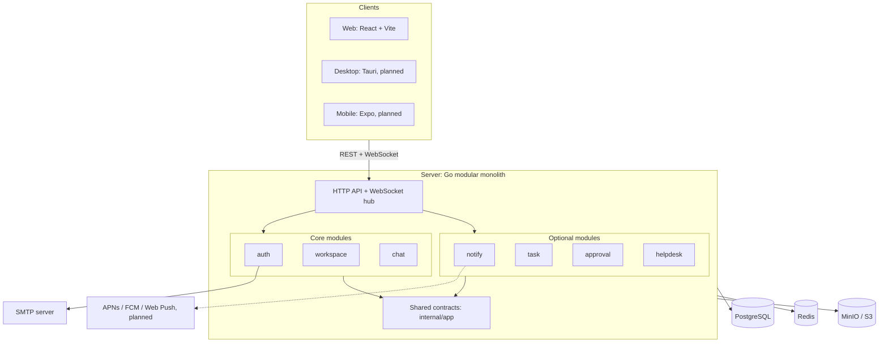
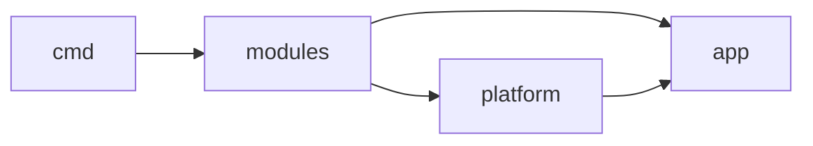
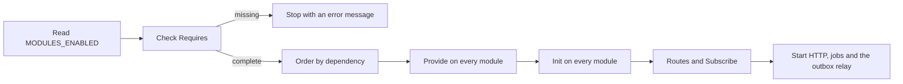
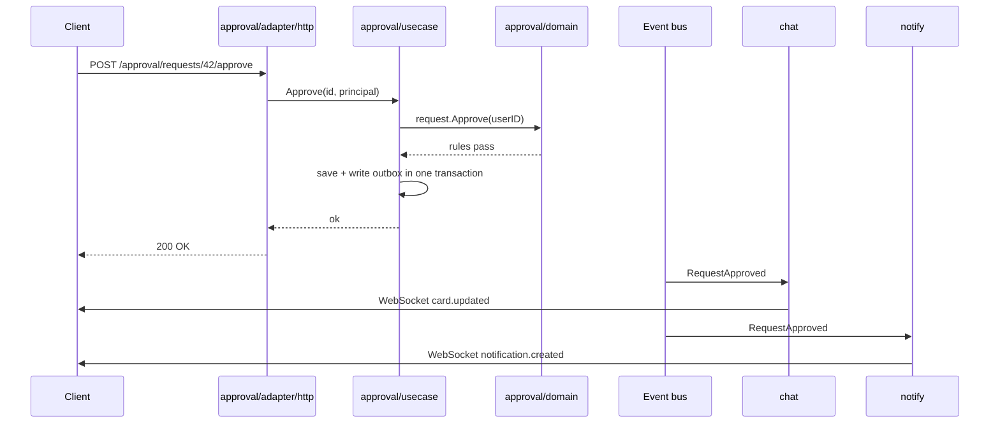

# Samnak Chat Architecture

This document describes what the system is made of, how the parts talk to each other, and why the main decisions were made. It is written for anyone who will change the code or add a module. System requirements live in [`srs.md`](./srs.md).

Sections describe the code on the release branch. Anything that is planned but not built is marked **planned**.

## 1. Overview

Samnak Chat is a self-hosted chat for organizations with work management built in: tasks, approval requests and a helpdesk, all usable from inside a conversation.

The server is a **modular monolith** written in Go. It is one program and one deployment, split into feature modules that can be switched on or off. Each module uses **Clean Architecture** internally.



## 2. Design principles

1. **Modules do not call each other directly.** A module publishes an event and other modules subscribe. The publisher does not know who is listening.
2. **Disabling a module must not break the system.** A bad configuration stops the server at startup with a clear message, instead of failing when a user clicks a button.
3. **Business rules live in the domain layer,** which knows nothing about the database, HTTP or JSON.
4. **The database is the source of truth.** WebSocket and push only tell clients sooner.
5. **The API is not tied to any client.** Everything the web app does goes through the public API, so desktop and mobile can use it too.

## 3. Server layout

```
apps/server/
├── cmd/
│   ├── server/main.go        # composition root: wires modules and starts the server
│   └── migrate/main.go       # runs the migrations of the enabled modules
├── internal/
│   ├── app/                  # shared contracts: interfaces and types only
│   ├── platform/             # infrastructure, no business logic
│   ├── modules/              # all features
│   │   ├── auth/  workspace/  chat/           core
│   │   └── notify/  task/  approval/  helpdesk/   optional
│   ├── archtest/             # test that fails on a forbidden import
│   └── acceptance/           # tests that run several modules together over HTTP
├── api/openapi.yaml          # generated from the code by make openapi
└── Dockerfile                # builds the server and migrate images
```

### 3.1 `internal/app`: shared contracts

| File | Contents |
| --- | --- |
| `module.go` | The `Module` interface, and the lists of core and default modules |
| `deps.go` | The `Deps` struct passed to every module at startup |
| `registry.go` | Checks dependencies, orders modules, and runs Provide, Init, Routes and Subscribe |
| `event.go` | `Event`, `Publisher`, `Handler` and `EventBus` (with `Subscribe` and `Declare`) |
| `services.go` | Service registry: `Provide` and `Lookup` |
| `notification.go` | `Notification`, `NotificationRule`, `NotificationRegistry` |
| `card.go` | `Card`, `CardKind` and `CardRegistry` for chat cards |
| `chat.go` | `ChatExtensions` (slash commands and message actions), `ChannelAccess` and `MessageReader` |
| `auth.go` | `Principal` (current user, workspace and role) carried in the context, and the authentication contract |
| `jobs.go` | `Jobs`: the job queue, with `Handle`, `Every` and `Enqueue` |
| `mail.go` | `Mail` and `Mailer`: sends one plain-text email |
| `realtime.go` | `Envelope` and `Realtime`: send to users, check who is online, close a device's sockets, and handle client messages |
| `storage.go` | `ObjectStorage`: presigned upload and download URLs, and `Stat` |
| `tx.go` | `TxManager`: runs a function in a transaction |
| `errors.go` | Standard errors: NotFound, Forbidden, Conflict, Invalid, RateLimited |

This package imports nothing else from the project. Modules depend on it instead of on each other.

### 3.2 `internal/platform`: infrastructure

| Package | Responsibility |
| --- | --- |
| `config` | Reads configuration from the environment |
| `database` | pgx pool, `TxManager`, and the platform migrations (the outbox table) |
| `redis` | Redis client |
| `storage` | Presigned URLs for uploads and downloads, for MinIO or S3 |
| `mail` | SMTP mailer. With `SMTP_HOST` empty, a mailer that writes to the log |
| `eventbus` | `EventBus` implementations: in-memory (for tests) and the outbox with its relay |
| `jobs` | Job queue (River) on PostgreSQL |
| `ratelimit` | Counters for limits, kept in Redis or in memory |
| `realtime` | WebSocket hub, presence, and fan-out through Redis |
| `httpx` | Router, middleware, the Huma API, error-to-JSON mapping, and the `/healthz`, `/readyz` and `/meta` endpoints |
| `observability` | Prometheus metrics for HTTP requests, and the `/metrics` handler |

`platform` knows no feature. For example, `realtime` knows how to deliver a payload to a user, but not whether that payload is a chat message or a ticket.

## 4. Dependency rules



- `cmd` is the only place that knows every module.
- A module may import only `api.go` and `events.go` from another module. Those two files are its public surface.
- Importing another module's `domain`, `usecase` or `adapter` is forbidden.
- Reading or writing another module's tables is forbidden.

The rules are checked in two places:

- `depguard` in golangci-lint fails the build when `internal/app` imports the platform or modules, or when `internal/platform` imports a module.
- `internal/archtest` runs with `go test`. It fails when a module imports another module's `domain`, `usecase` or `adapter`.

The rule about tables is checked in review and by the acceptance tests.

## 5. Modules

### 5.1 Interface

```go
type Module interface {
    Name() string
    Requires() []string        // modules this one cannot run without
    Provide(s *Services)       // phase 1: expose services to other modules
    Init(d *Deps) error        // phase 2: build use cases, register rules (no I/O)
    Routes(api huma.API)       // register Huma operations under /api/v1/{name}
    Subscribe(bus EventBus)    // listen to events from other modules
}
```

### 5.2 Startup sequence



`Provide` runs on every module before any `Init` runs, so modules can look up each other's services regardless of order. The job queue and the outbox relay start after the modules, so every handler is registered before the first event or job runs.

### 5.3 Inside a module

```
approval/
├── module.go            # wires adapters to use cases and registers with the system
├── api.go               # interfaces other modules may call
├── events.go            # events this module publishes
├── domain/              # entities and business rules
├── usecase/             # application flows and ports (required interfaces)
├── adapter/
│   ├── http/            # handlers and JSON shapes
│   ├── postgres/        # Repository implemented with sqlc
│   └── wire/            # builds the adapters for module.go
└── migrations/          # migrations of this module's tables
```

Dependencies inside a module point one way: `adapter → usecase → domain`. Inner layers do not know outer layers.

| Layer | Contains | Must not contain |
| --- | --- | --- |
| domain | Entities, state transitions, business errors | SQL, HTTP, JSON tags, calls to other modules |
| usecase | The steps of one capability, transaction boundaries, ports | pgx or sqlc types, `http.Request` |
| adapter | Input and output mapping, calls to external systems | Business rules |

A simple module does not need every layer. Interfaces are created only where a boundary is crossed: the database, events and other modules. Background work is registered in `module.go` with `Jobs.Handle` and, for periodic work, `Jobs.Every`.

## 6. Communication between modules

There are four mechanisms, listed in order of preference.

| Mechanism | Use it to | If the target module is disabled |
| --- | --- | --- |
| Event bus | Announce that something happened | No subscribers; not an error |
| Notification registry | Notify a user | Rules are registered but never read, so nothing runs |
| Card registry | Show a card in chat | chat is a core module and is always on |
| Service registry | Query or command another module synchronously | `Lookup` returns `false`; use a fallback |

### 6.1 Event bus

```go
type Event interface {
    EventName() string        // e.g. "approval.request_approved"
}

type Publisher interface {
    Publish(ctx context.Context, evt Event) error
}
```

- An event is a struct declared in the publishing module's `events.go`, named in the past tense. The module lists the events it publishes inside transactions with `Declare` in `Init`.
- A handler that returns an error or panics is logged and does not affect the publisher.
- Outside a transaction, `Publish` runs the handlers at once. Inside `TxManager.Do`, the event is written to the `platform_outbox_events` table in the same transaction as the data. It is delivered only after the commit.
- The relay finds new rows with PostgreSQL `LISTEN`/`NOTIFY`, and polls every 2 seconds as a backstop. Each event is handled on one server instance. A rolled-back transaction delivers nothing.
- Delivery is at least once, so handlers must be idempotent.
- Published rows are deleted after 7 days by the job `platform.outbox_prune`.
- Fields may be added to an event. Existing fields must not be removed or change meaning.

### 6.2 Notification registry

The source module decides who is notified and what the message says. The notify module decides whether the user gets it.

```go
d.Notifications.On("approval.request_approved",
    func(ctx context.Context, evt app.Event) ([]app.Notification, error) {
        e := evt.(RequestApproved)
        return []app.Notification{{
            UserID: e.RequesterID,
            Kind:   "approval.approved",
            Title:  "Your request was approved",
            Link:   "/approvals/" + e.ID,
        }}, nil
    })
```

notify stores each notice once, drops notices of a switched-off kind or in a muted channel, and sends the rest over the WebSocket to the user's open connections. Users who are offline see the notice in their list. Push and email from notify are **planned**, not built.

### 6.3 Card registry

A chat message has `kind`, `payload` and `fallback_text`. A module registers its own card kinds, such as `approval.request`. The chat module stores and delivers cards without understanding the `payload`.

When state changes, the owning module calls `Cards.Update(ctx, workspaceID, messageID, payload)`. Only the module that registered the kind may update it. chat then sends `card.updated` to everyone in the channel. If the owning module is disabled, clients show `fallback_text`.

### 6.4 Service registry

```go
// provider, in chat's Provide
app.Provide[app.ChatExtensions](s, m.ext)

// consumer, in Init: skip the registration when chat is missing
ext, ok := app.Lookup[app.ChatExtensions](d.Services)
if ok {
    ext.RegisterCommand(app.Command{Name: "task", Module: "task", Usage: "/task <title>", Handler: h})
}
```

Use it only when an event is not enough, for example when the caller needs a result immediately. The current services are `ChatExtensions`, `ChannelAccess`, `MessageReader`, `CardRegistry`, `Authenticator`, `Directory`, `MembershipResolver` and `Authorizer`.

## 7. Enabling and disabling modules

- `MODULES_ENABLED` lists the optional modules to enable. Core modules (`auth`, `workspace`, `chat`) are always on. When the variable is not set, `notify` is on.
- Hard dependencies are declared in `Requires()`. If one is missing, the server does not start.
- Soft dependencies use `Lookup` with a fallback.
- Endpoints of a disabled module are never mounted, so they return 404.
- `GET /api/v1/meta` returns the server name, its version and the enabled modules, so clients can hide menus.
- Disabling a module keeps its tables and data. Enabling it again picks up where it left off.
- Jobs with no registered worker are cancelled instead of staying in the queue.
- CI starts the server with each module set in the `modules` job. `scripts/check-modules.sh` checks `/healthz`, `/meta` and the routes of the optional modules.

## 8. Data

### 8.1 Tenant isolation

Every table that holds organization data has a `workspace_id` column, and queries filter on it. Middleware (`RequireUser` and `RequireMember`) checks that the user is a member of the workspace and puts a `Principal` into the context. Use cases read `workspace_id` from the `Principal` only, never from client input. An acceptance test calls each workspace-scoped endpoint with a member of another workspace and expects 403 or 404.

### 8.2 Tables and migrations

- Table names are prefixed with the module name, such as `chat_messages` and `helpdesk_tickets`. The outbox table is `platform_outbox_events`.
- Migrations live in each module's folder and use goose. `cmd/migrate` runs them only for enabled modules.
- IDs are UUIDv7. Timestamps are `timestamptz` in UTC.
- A module refers to another module's data by ID only. There are no foreign keys across modules, so a module can be disabled or split out.

### 8.3 Transactions

`TxManager` keeps the transaction in the `context`, so a use case sets the transaction boundary without knowing pgx.

```go
return uc.Tx.Do(ctx, func(ctx context.Context) error {
    r, err := uc.Repo.Get(ctx, id)
    if err != nil { return err }
    if err := r.Approve(userID); err != nil { return err }
    if err := uc.Repo.Save(ctx, r); err != nil { return err }
    return uc.Pub.Publish(ctx, RequestApproved{ID: r.ID})
})
```

### 8.4 Files

- Uploads and downloads go straight from the browser to the object store, using presigned URLs. Each URL works for 15 minutes.
- The server signs the URL with `S3_ENDPOINT`. The signature covers the host, so a browser needs the public address. `S3_PUBLIC_ENDPOINT` sets it when storage sits behind a proxy. In the production stack it is `PUBLIC_URL`, and Caddy forwards the bucket path to MinIO.
- The server checks an upload with `Stat` before it attaches the file to a message or ticket.
- Object keys start with the module name, such as `chat/...`. A module writes and deletes only its own keys. Another module may create a download URL for a file it can see, but it never writes or deletes the file.

## 9. Realtime

### 9.1 Message guarantees

| Problem | Solution |
| --- | --- |
| Duplicate sends after a network drop | The client generates `client_msg_id`; the database enforces uniqueness on (sender_id, client_msg_id) |
| Different order on different devices | The server assigns a per-channel `seq` that increases by one; the database enforces uniqueness on (channel_id, seq) |
| Messages missed while offline | After reconnecting, the client calls `messages?after_seq=` over REST |

### 9.2 WebSocket hub

- Each connection has one reader and one writer goroutine.
- The hub keeps each user's connections in the memory of that server instance.
- With several instances, messages fan out through Redis pub/sub, and each instance forwards to the connections it holds.
- Presence is stored in Redis with an expiry and refreshed by client `ping` messages. The hub limits how often a client's pings write to Redis.
- The WebSocket does not replay history. Catching up always goes through REST.

## 10. Background jobs

The job queue is River, which stores jobs in PostgreSQL. A job can be enqueued in the same transaction as the data, and there is no extra service to run.

| Job | Module | Kind | When |
| --- | --- | --- | --- |
| Send email, with retries | auth | `auth.send_email` | Enqueued by sign-up, resend and password reset |
| Remind about tasks due within 24 hours, and overdue tasks | task | `task.due_scan` | Every 5 minutes |
| Delete read notifications older than about 90 days | notify | `notify.prune` | Every 24 hours |
| Delete published outbox rows older than 7 days | platform | `platform.outbox_prune` | Daily |
| Check SLAs and auto-close tickets | helpdesk | **planned** | Not built. helpdesk has no periodic job yet |
| Send push notifications | notify | **planned** | Not built |

The outbox relay is not a job. It runs as a goroutine in the server process and publishes events as described in section 6.1.

### 10.1 Health, metrics and logs

| Endpoint or output | What it tells you |
| --- | --- |
| `GET /healthz` | The process is up |
| `GET /readyz` | The database and Redis answer. Returns 503 and the names of the failing checks otherwise |
| `GET /metrics` | Prometheus text format: `http_request_duration_seconds` (by route pattern, method and status; WebSocket handshakes are not timed), `ws_connections` (gauge), `ws_messages_sent_total` (counter), and the Go runtime and process metrics |
| Server log | One JSON object per line on stdout |

`/metrics` has no authentication. The production proxy does not forward it, so it is reachable only inside the stack.

## 11. Example: a manager approves a leave request



With notify disabled, the last step does not happen. Everything else works the same.

## 12. Authentication and authorization

- The access token is a JWT that lives 15 minutes. The refresh token lives 30 days, is bound to a device and rotates on every use.
- If an old refresh token is reused, the device it belongs to is revoked, and its open sockets are closed.
- Failed sign-ins are limited to 5 a minute for each email address and for each IP address. Resending a verification email is limited too.
- Permissions are checked in the use case layer with `Authorizer.Can(principal, action)`, provided by the workspace module as a service. Each module adds its own actions through `ActionRegistry` in `Init`.
- Rules that depend on entity state, such as "only the named approver", live in the domain layer.
- Sign-in does not wait for email verification. The `email_verified` field tells the client whether the address was confirmed.
- A general limit on all API calls is **planned** (M6-12). Today, only the sign-in, resend and typing limits exist.

## 13. Clients

```
apps/web/        # React + Vite, built and shipped in the production stack
apps/desktop/    # Tauri wrapping the web build (planned, phase P2)
apps/mobile/     # Expo (planned, phase P3)
packages/core/   # API client, OpenAPI types, WebSocket connection, chat logic
packages/ui/     # components shared by web and desktop (planned)
```

- `packages/core` uses no DOM or browser APIs, so the mobile app can share it.
- API types are generated from `openapi.yaml` into `packages/core/src/api/schema.d.ts` with `openapi-typescript`. CI fails when the generated files do not match the code.
- Clients render cards by `kind`. An unknown kind is shown as `fallback_text`.
- Clients call `/meta` at startup and show menus only for enabled modules.

## 14. Testing

| Level | What it tests | Tools |
| --- | --- | --- |
| Unit | domain and usecase with fakes | `go test` and the standard `testing` package |
| Integration | adapters against real PostgreSQL and Redis | testcontainers-go |
| API and acceptance | the server over HTTP and WebSocket, several modules together | `httptest`, `internal/acceptance` |
| Architecture | forbidden imports between modules and layers | `internal/archtest` |
| Module combinations | server startup with each module set | `scripts/check-modules.sh` in the `modules` CI job |
| Coverage | at least 80% of statements in domain and usecase packages (NFR-12) | `scripts/coverage.sh` in CI |
| Web | component tests with the whole app and a mocked server | Vitest and jsdom (`renderApp`) |
| End to end | main user journeys in a real browser | Playwright, **planned**. Not in the repository yet |

CI also runs the server tests with `-race`.

## 15. Adding a module

1. Create `internal/modules/<name>` following the layout in section 5.3.
2. Write `module.go` so it satisfies `Module`, and declare `Requires()`.
3. Add migrations with table names prefixed by the module name.
4. Declare events in `events.go`, and register notification rules and card kinds in `Init`.
5. Add the module to the list in `cmd/server/main.go`.
6. Add the module to the `modules` matrix in `.github/workflows/ci.yml`, so CI starts the server with it.

Done correctly, this changes no file in any other module.

## 16. Decision records

Details and rejected alternatives are in [`adr/`](./adr/).

| No. | Decision | Reason in brief |
| --- | --- | --- |
| [0001](./adr/0001-modular-monolith.md) | Modular monolith instead of microservices | Easy for a small team to run, and modules can be split out later |
| [0002](./adr/0002-clean-architecture-per-module.md) | Clean Architecture inside each module | Business rules can be tested without a database |
| [0003](./adr/0003-event-bus-with-outbox.md) | Event bus with an outbox | Modules stay decoupled and events survive a crash |
| [0004](./adr/0004-chi-on-net-http.md) | Chi on `net/http` | Works with every standard Go library |
| [0005](./adr/0005-sqlc-instead-of-orm.md) | sqlc instead of an ORM | Explicit SQL with compile-time type checks |
| [0006](./adr/0006-river-job-queue.md) | River instead of a separate queue | Reuses PostgreSQL and enqueues inside transactions |
| [0007](./adr/0007-per-channel-seq-and-client-msg-id.md) | Per-channel `seq` and `client_msg_id` | No duplicates and the same order on every device |
| [0008](./adr/0008-web-and-mobile-separate-shared-core.md) | Web separate from mobile, sharing `packages/core` | Each platform gets a fitting UI without duplicating logic |
